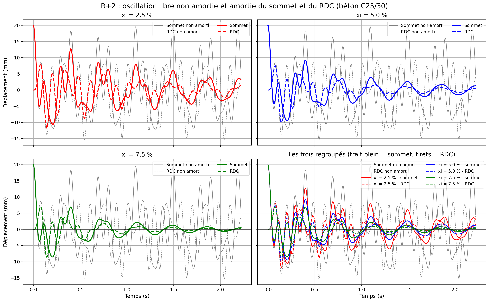
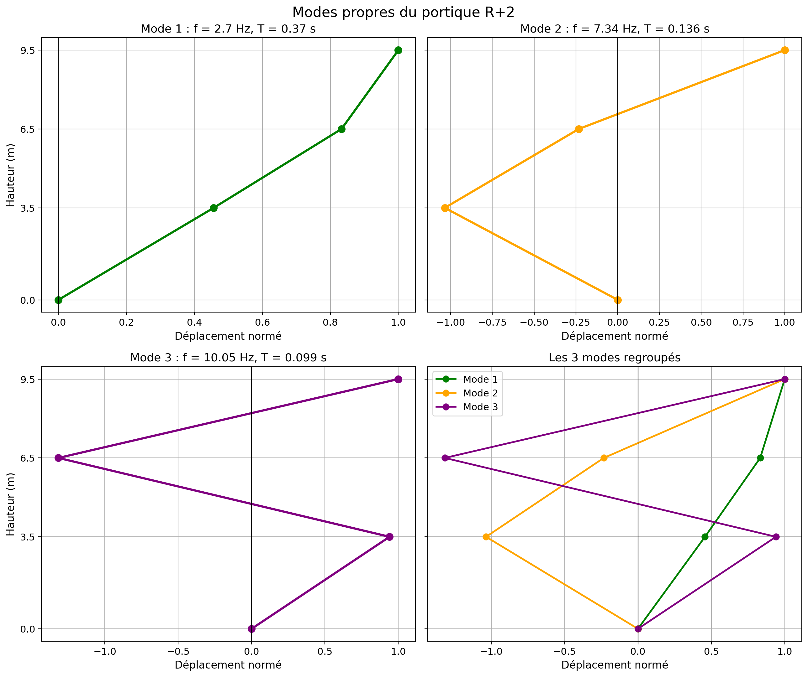
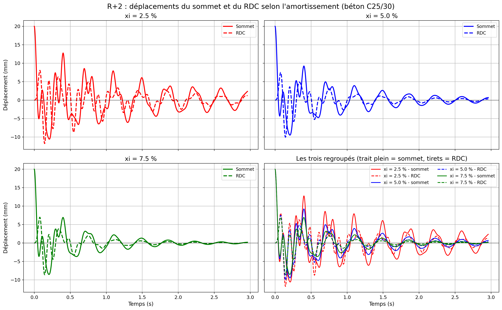
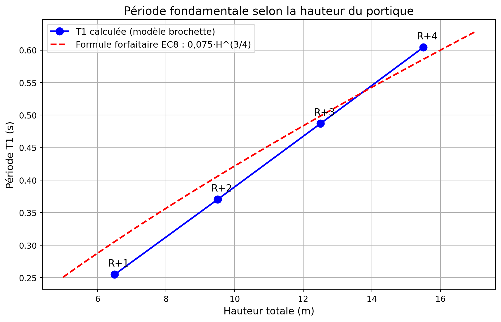

# Oscillation libre de portiques

Analyse dynamique de portiques en béton armé, du R+1 au R+4, modélisés en
brochette à N degrés de liberté (un par plancher). Le sommet est déplacé de
2 cm puis relâché sans vitesse : le programme calcule la réponse libre, non
amortie et amortie, de chaque niveau.



## Ce que fait le programme

- Matrices de masse et de rigidité pour N degrés de liberté (poteaux encastrés)
- Pulsations, fréquences, périodes et modes propres
- Réponse en oscillation libre par superposition modale, avec et sans amortissement (ξ = 2,5 / 5 / 7,5 %)
- Sensibilité à la classe de béton (C20/25 à C40/50, Ecm de l'Eurocode 2)
- Comparaison de la période fondamentale à la formule forfaitaire de l'Eurocode 8
- Récapitulatif des quatre bâtiments, en tableau et en figures

## Données

| | RDC | Étage courant |
|---|---|---|
| Hauteur | 3,50 m | 3,00 m |
| Poteaux (3 par niveau) | 0,40 × 0,40 m | 0,35 × 0,35 m |
| Masse du plancher | 45 t | 45 t (30 t au sommet) |

Béton de référence C25/30 (E = 31 000 MPa), amortissement de référence ξ = 5 %.

## Lancer

```bash
pip install -r requirements.txt
python portiques.py
```

Les figures s'enregistrent dans des dossiers `Figures R+1` … `Figures récap`
à côté du script. Pour les enregistrer sans ouvrir de fenêtres :

```bash
AFFICHER_FIGURES=0 python portiques.py
```

## Quelques résultats

| | R+1 | R+2 | R+3 | R+4 |
|---|---|---|---|---|
| Période T1 (s) | 0,255 | 0,370 | 0,487 | 0,604 |
| Période forfaitaire EC8 (s) | 0,305 | 0,406 | 0,499 | 0,586 |
| Temps pour tomber à 5 %, ξ = 5 % (s) | 2,43 | 3,53 | 4,64 | 5,76 |





---

Cheikh Oumar Sy — ingénieur génie civil, structures · [cosinus28.vercel.app](https://cosinus28.vercel.app)
